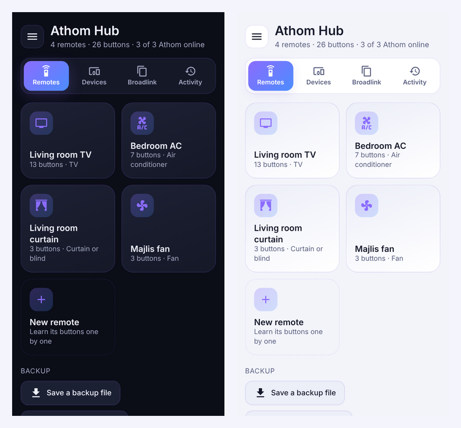
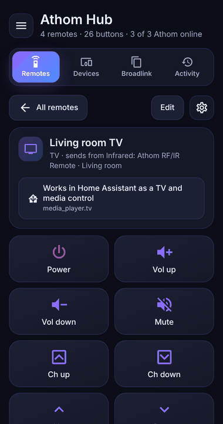
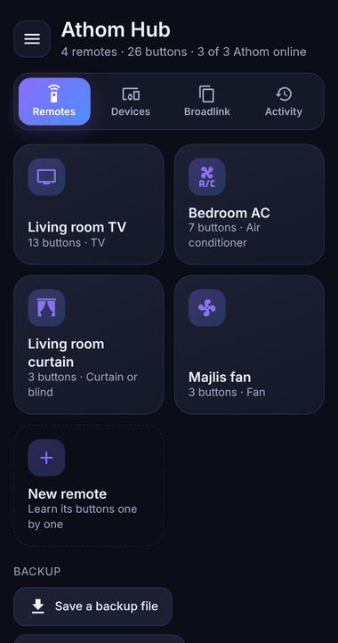
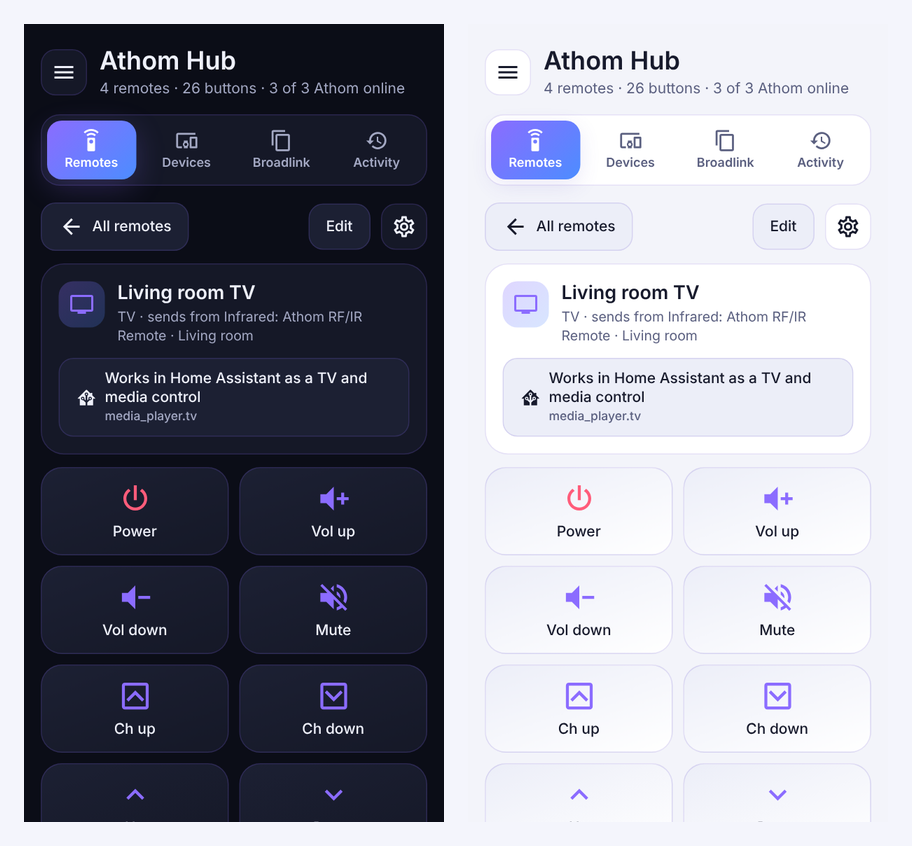
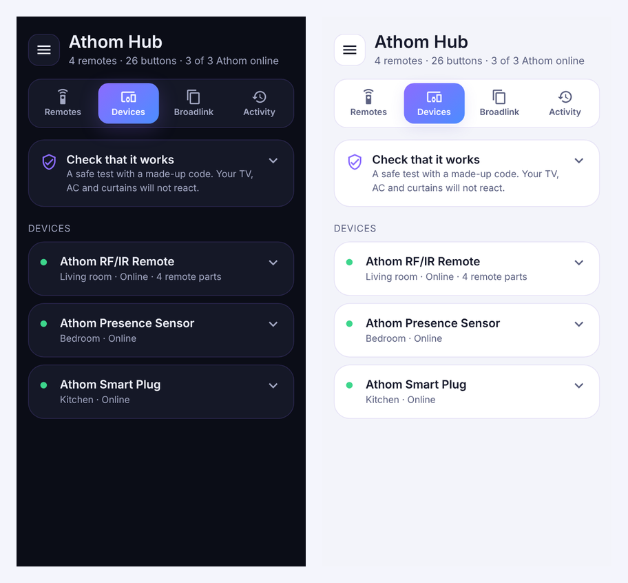
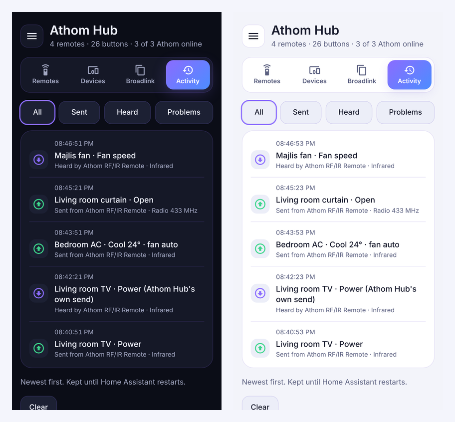

<p align="center"></p>

<p align="center"><b>Use your Athom RF/IR Remote and other Athom devices with Home Assistant. No coding, no re-flashing.</b><br>
Learn remotes · bring in Broadlink codes · turn them into real TVs, ACs, curtains and fans</p>

<p align="center">
<a href="https://hacs.xyz"></a>
<a href="https://github.com/HRadhi4/Athom-Hub/releases/latest"></a>
<a href="https://github.com/HRadhi4/Athom-Hub/actions/workflows/validate.yml"></a>
<a href="LICENSE"></a>
<a href="https://ko-fi.com/hradhi4"></a>
</p>

<p align="center">
<a href="https://my.home-assistant.io/redirect/hacs_repository/?owner=HRadhi4&repository=Athom-Hub&category=integration"></a>
</p>



## Highlights

- **A friendly page in your sidebar.** Big picture buttons, plain words, works on a phone. Made so anyone at home can use it.
- **Learn any remote**, one button at a time: TV, air conditioner, fan, curtains, sockets. Infrared and 433 MHz radio.
- **Bring in Broadlink codes**: paste the codes a Broadlink learned, or choose a saved file of them, and copy each remote in one tap.
- **Real devices, not just buttons.** An AC remote becomes a thermostat, a curtain remote a curtain, a TV remote a media player. They work with normal cards, automations and voice.
- **Air conditioners done right.** Full code sets from SmartIR's library (395 files, 110 brands), and Home Assistant follows when someone uses the **real** remote.
- **Presence sensor made easy.** A live room map where you draw zones with your finger, and every setting in plain words.
- **See everything.** A live list of what was sent and what the Athom heard.

| | | |
|:-:|:-:|:-:|
| <br>**Learn a button** | <br>**Copy from a Broadlink** | <br>**Press with a tick** |

## Install

[](https://my.home-assistant.io/redirect/hacs_repository/?owner=HRadhi4&repository=Athom-Hub&category=integration)
[](https://my.home-assistant.io/redirect/config_flow_start/?domain=athom_hub)

1. Tap the first button (or open **HACS** and search for **Athom Hub**), then **Download**.
2. **Restart** Home Assistant.
3. Tap the second button (or *Settings → Devices & services → Add integration → Athom Hub*), then **Submit**.
4. Open **Athom Hub** in the sidebar.

You need Home Assistant **2026.11** or newer, and your Athom device added to Home Assistant (it appears by itself through ESPHome). Step by step, and without HACS: **[Install guide](docs/tutorials/01-install.md)**.

## Tutorials

Short, written, with pictures:

1. [Install Athom Hub](docs/tutorials/01-install.md) · 5 min
2. [Bring in your Broadlink codes](docs/tutorials/02-copy-broadlink.md) · 1 min per remote
3. [Learn a button from any remote](docs/tutorials/03-learn-a-button.md) · 30 s per button
4. [Use your remotes in Home Assistant](docs/tutorials/04-use-in-home-assistant.md)
5. [Air conditioners: the full code set](docs/tutorials/05-air-conditioners.md)
6. [Presence sensor: room map and zones](docs/tutorials/06-presence-sensor.md)
7. [See what was sent and heard](docs/tutorials/07-activity.md)
8. [Put your remotes on your dashboard](docs/tutorials/08-on-your-dashboard.md)

<details>
<summary><b>More screenshots</b></summary>

**A remote**


**Your Athom devices**


**Activity**


</details>

## Works great with Roost Cards

[Roost Cards](https://github.com/HRadhi4/Roost-card) has a **remote pad**, a **thermostat dial**, **sliding curtains** and a **presence map** made for Athom Hub. See [tutorial 8](docs/tutorials/08-on-your-dashboard.md).

---

## Air conditioners

The Athom RF/IR Remote also has a built-in **air conditioner** control (a *climate* entity), which speaks one AC brand's "language". Out of the box it is set to **Coolix**, used by Midea and the many AC brands Midea builds for.

**How to find out if your AC speaks Coolix:**
1. Open Athom Hub → **Add a button** → **Infrared**, and press your AC remote's power button.
2. In *Settings → Devices & services → ESPHome → Athom RF/IR Remote*, open the AC control, turn it on and set a temperature.
3. If your AC beeps and follows, you are done: use that climate entity.

If it does not react, your AC speaks another language. Learn the buttons you need (power, cool, temperature up and down) as normal buttons instead.

---

## Good to know

- **Broadlink codes** are pasted or chosen from a file you saved; Athom Hub never reads other integrations' storage. Codes that only live in the Broadlink phone app can't be exported, so learn those buttons again with Athom Hub.
- **Rolling-code remotes** (garage doors, some gates and shutters) change their code every press. No device can copy them.
- **Radio replay through the Athom** works for simple 433 MHz remotes (curtains, sockets, doorbells). Test each button once after copying.
- The Athom's radio receiver hears background radio noise all the time. That is normal; Athom Hub only keeps a radio code after hearing the same signal at least three times.
- Codes are kept in Home Assistant's own storage and are included in Home Assistant backups.

## Questions and problems

| What you see | What to do |
|---|---|
| *No remote sender found* | Add the Athom RF/IR Remote to Home Assistant first (ESPHome). |
| *… is offline* | Check that the Athom has power and Wi-Fi. |
| *Nothing clear was heard* | Come closer, point straight at the Athom, avoid bright sunlight. For radio, hold the button longer. |
| The button sends but the device does not react | Learn it again, standing closer. For an AC, learn it with the AC already off. |
| Something else | [Open an issue](https://github.com/HRadhi4/Athom-Hub/issues/new/choose) with a screenshot of Athom Hub's Activity tab. |

## For developers

The code-conversion maths (`custom_components/athom_hub/codes.py`) has no Home Assistant imports and is tested on its own:

```
python -m pytest tests
```

Athom Hub sends and listens through Home Assistant's `infrared` and `radio_frequency` entity platforms, so any emitter or receiver that Home Assistant offers there can be used, not only Athom devices.

## Support

If Athom Hub makes your home nicer, you can buy me a coffee on Ko-fi. It helps me keep adding features and fixing problems.

<a href="https://ko-fi.com/hradhi4"></a>

## License

GPL-3.0. See [LICENSE](LICENSE).
