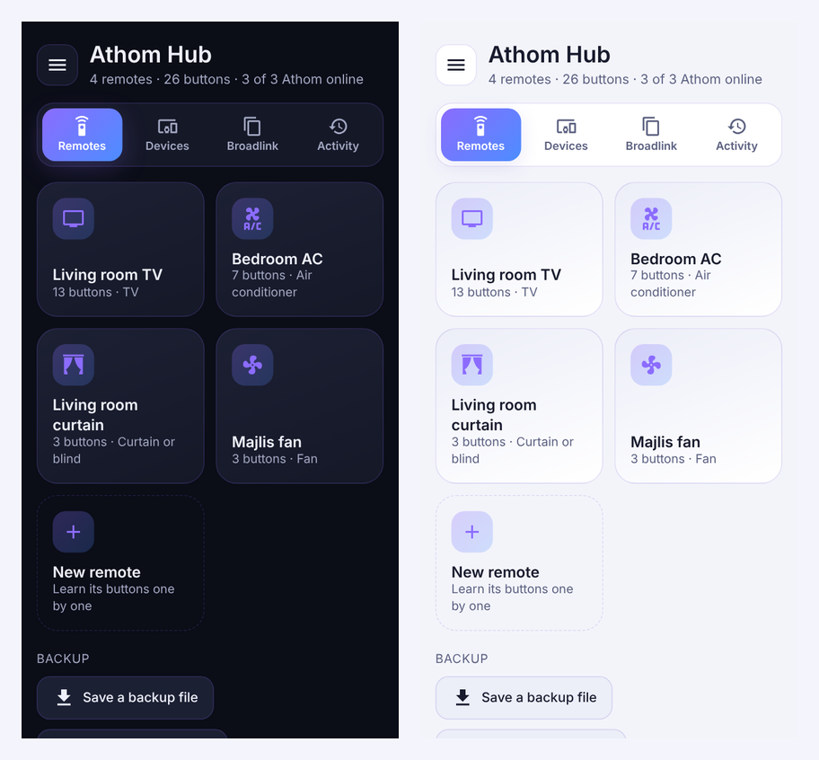

# 1 · Install Athom Hub

**Time: 5 minutes.** You need Home Assistant **2026.11 or newer**, [HACS](https://hacs.xyz), and your Athom RF/IR Remote already added to Home Assistant (it shows up by itself under *Settings → Devices & services → ESPHome*).

## Download it

1. Tap this button. It opens Athom Hub inside HACS on your own Home Assistant:

   

   *No button?* Open **HACS** and search for **Athom Hub**.
2. Tap **Download**, then **Download** again.
3. **Restart** Home Assistant: *Settings → System → Restart* (top right) → **Restart Home Assistant**.

> **Not found in HACS?** Until Athom Hub is in the HACS store, add it once by hand: HACS → the **three dots** at the top right → **Custom repositories** → paste `https://github.com/HRadhi4/Athom-Hub` → type **Integration** → **Add**. Then search again.

## Turn it on

1. Tap this button (or go to *Settings → Devices & services → Add integration* and search **Athom Hub**):

   
2. Tap **Submit**. There is nothing to fill in.
3. **Athom Hub** now appears in the sidebar (for administrators).

**Next:** [Copy your Broadlink remotes →](02-copy-broadlink.md) or [Learn a button →](03-learn-a-button.md)
