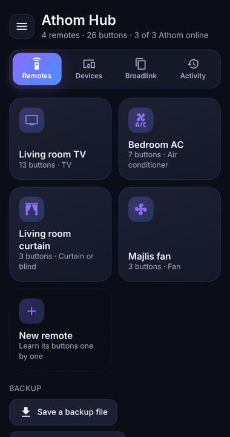

# 2 · Copy your Broadlink remotes

**Time: 1 minute per remote.** If a Broadlink already learned your remotes in Home Assistant, copy them in one tap.

1. Open **Athom Hub → Broadlink**.
2. Tap a remote to see its buttons.
3. Tap **Copy to Athom Hub**. The new remote opens.
4. Press each button once and check that the real device reacts.

The Broadlink keeps working. Nothing is removed from it.

> **Can't see a remote?** Remotes learned only in the Broadlink phone app are not in Home Assistant, so they can't be copied: [learn those buttons](03-learn-a-button.md) instead. **Rolling-code** remotes (garage doors, some gates) change their code every press; no device can copy them.

**Next:** [Learn a button →](03-learn-a-button.md)
