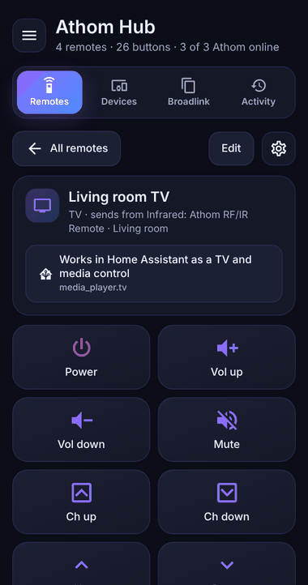

# 3 · Learn a button from any remote

**Time: 30 seconds per button.**

1. **Remotes → New remote.** Give it a name (for example *Living room TV*) and choose what it controls. *(Or open a remote you already have.)*
2. Tap **Add a button**, then choose:
   - **Infrared**: TV, air conditioner, fan, audio. You point the remote.
   - **Radio 433 MHz**: curtains, sockets, doorbells. Works through walls.
3. When it says **Press the button now**:
   - **Infrared:** point the remote at the Athom from about 30 cm and press **once**.
   - **Radio:** hold the remote close to the Athom and **keep the button pressed** for about two seconds.
4. **Got it ✓** → tap **Try it**. Did the device react?
5. Type a name (*Power*, *Vol up*, *Netflix*…) and tap **Save button**.

> **Name buttons the normal way** ("Power", "Vol up", "Cool", "Open"). Athom Hub uses the name to understand what the button does, so the remote works as a real TV, AC or curtain in Home Assistant.

**Nothing heard?** Come closer, point straight at the Athom, and keep out of bright sunlight. For radio, hold the button longer.

**Next:** [Use your remotes in Home Assistant →](04-use-in-home-assistant.md)
