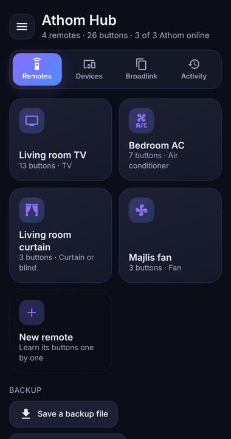

# 4 · Use your remotes in Home Assistant

## Press buttons on the page

Open a remote and tap a button. A green tick and a short vibration mean the code was sent.

## Real devices, not just buttons

Each remote becomes a real device, so it works with the normal cards, automations and voice:

| Remote is a… | Becomes | Works with |
|---|---|---|
| Air conditioner | `climate` | Thermostat card, `climate.set_hvac_mode`, voice |
| Curtain or blind | `cover` | Curtain or tile card, `cover.open_cover` |
| TV or audio | `media_player` | Media card, `media_player.turn_on`, volume |
| Fan | `fan` | Fan card |
| Light | `light` | Light card |

Every button is also a normal `button` entity, for automations.

## Change what a button does

Open the remote → **Edit** → **Name and picture** on a button → **What this button does**. Here you can also pick its icon and colour.

## Room temperature for an AC

Open the AC remote → the **gear** ⚙️ → **Room temperature sensor**. The thermostat card then shows the real room temperature.

> These devices can't tell Home Assistant what they're doing, so their state is what Athom Hub last sent. For air conditioners with a full code set, Athom Hub also follows the **real remote** ([next tutorial](05-air-conditioners.md)).

**Next:** [Air conditioners →](05-air-conditioners.md)
