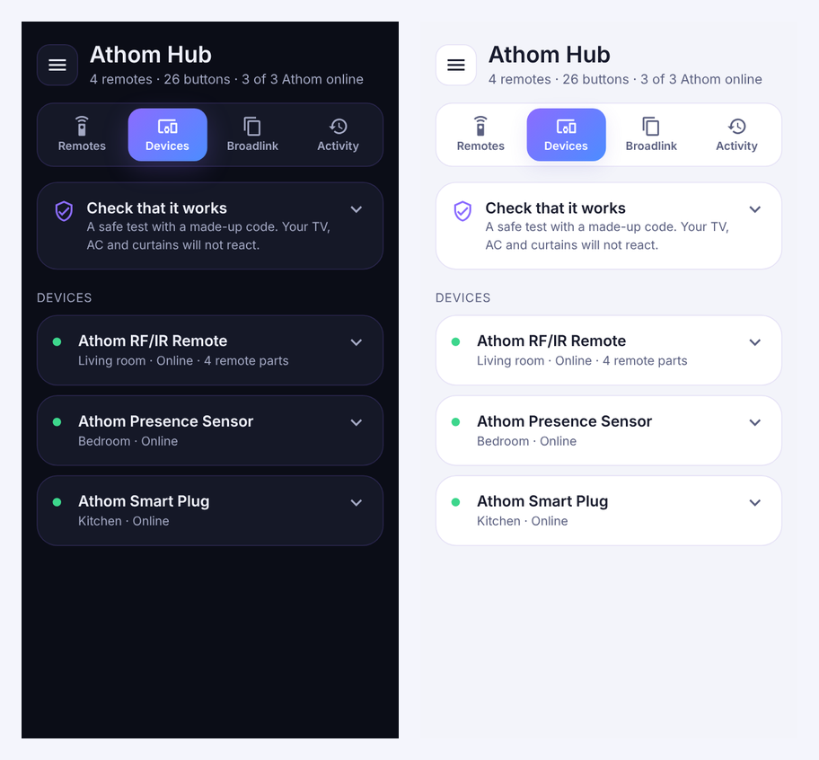

# 6 · Presence sensor (LD2450): room map and zones

1. Open **Devices** and tap your **Athom Presence Sensor**, then **Settings and controls**.
2. **Room map:** the sensor is at the top, looking into the room. The people it sees are dots that move.
3. Choose **Zone 1, 2 or 3**, then **drag on the map** to draw it. Drag inside a zone to move it, or drag a corner to resize it. Tap **Save zone**.
4. **What the zones do:** off, *only see people inside the zones*, or *ignore people inside the zones* (for example a fan or curtain that moves).
5. The other settings are plain switches: how long the room stays "present" after someone leaves, tracking up to 3 people, Bluetooth, the status light. **Restart** and **reset** are under *Advanced* and always ask first.

> With [Roost Cards](https://github.com/HRadhi4/Roost-card), the **Roost Presence Map** card shows the same live map on your dashboard.

**Next:** [The activity list →](07-activity.md)
