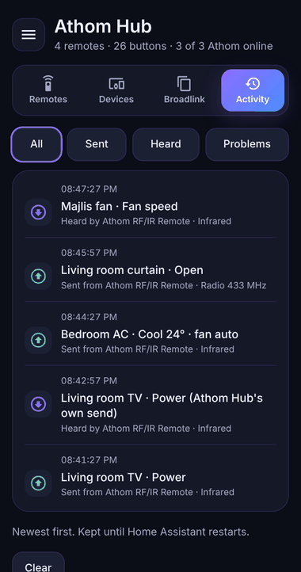

# 7 · See what was sent and heard

The **Activity** tab lists, live, every code that was **sent** (and whether it worked) and everything the Athom **heard**, including presses of your real remotes, by name.

- **Filters:** All · Sent · Heard · Problems.
- Radio background noise is left out. A button you saved is shown by its name when it is heard.
- The list is kept until Home Assistant restarts. **Clear** empties it.

**Next:** [On your dashboard →](08-on-your-dashboard.md)
